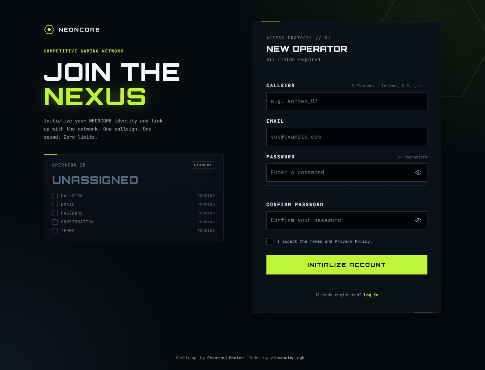
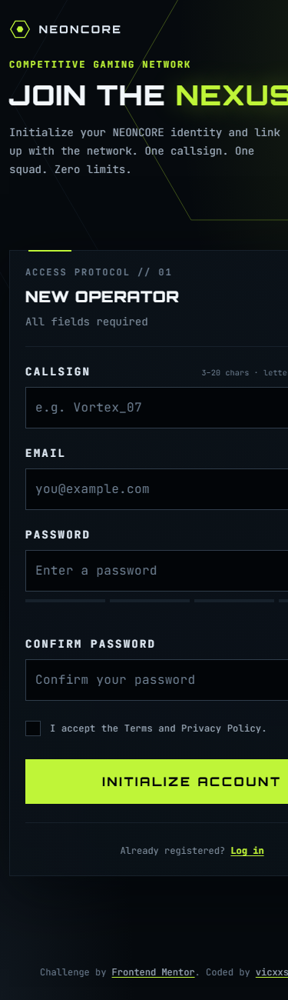

# NEONCORE — Gamer Sign-Up Form

A responsive, accessible sign-up experience for a competitive gaming network, built for the [Frontend Mentor Gamer sign-up form challenge](https://www.frontendmentor.io/challenges/gamer-sign-up-form). The project also includes a matching login page as an optional extension.



## Live demo

- **Live site:** [vicxxsotop-rgb.github.io/neoncore-gamer-signup](https://vicxxsotop-rgb.github.io/neoncore-gamer-signup/)
- **Login page:** [vicxxsotop-rgb.github.io/neoncore-gamer-signup/login.html](https://vicxxsotop-rgb.github.io/neoncore-gamer-signup/login.html)
- **Repository:** [github.com/vicxxsotop-rgb/neoncore-gamer-signup](https://github.com/vicxxsotop-rgb/neoncore-gamer-signup)
- **Frontend Mentor solution:** [NEONCORE — Responsive Gamer Form](https://www.frontendmentor.io/solutions/neoncore---responsive-gamer-form-fhabXh7yI5)
- **Challenge:** [Gamer sign-up form on Frontend Mentor](https://www.frontendmentor.io/challenges/gamer-sign-up-form)

## Overview

NEONCORE is a fictional competitive-gaming network. The sign-up form asks for a callsign, email, password, password confirmation, and acceptance of the terms.

Most of the work is in the form states: live validation, a password strength meter, show/hide password buttons, a loading state, and a success screen. Everything is designed to work with a keyboard and a screen reader.

### The challenge

Users should be able to:

- Fill in the form with a callsign, email, password, and password confirmation, and accept the terms.
- Receive validation messages when a field is missing or filled in incorrectly.
- Show and hide each password with the eye button.
- See the password strength meter update while typing.
- See a loading state, then a success message, after submitting.
- Complete the form using only the keyboard.
- Have inputs, hints, errors, and the success message announced by a screen reader.
- View the optimal layout on mobile, tablet, and desktop.
- See hover and focus states for every interactive element.

The Operator ID readout beside the form is an optional extra from the brief. It updates as each field becomes valid.

### Features

- Custom validation for callsign, email, password, confirmation, and terms.
- Live error clearing and a valid-field check icon.
- Password strength meter with four levels: Weak, Fair, Good, and Strong.
- Show/hide controls for both password fields.
- Loading state with `Transmitting_` and a blinking caret.
- Success screen with focus moved to the success heading.
- Live Operator ID panel on desktop.
- Matching login page with callsign-or-email validation, show/hide password, loading, and success states.
- Responsive layout from 320px to large desktop screens.
- Reduced-motion support, dark autofill, text selection, and scrollbar styling.

> **Demo only:** there is no backend. The forms simulate a 1.4-second request and do not send or store any data. The Terms and Privacy Policy text is shown for demonstration purposes; no legal pages are included.

## Screenshots

| Desktop | Mobile |
| --- | --- |
|  |  |

## Built with

- Semantic HTML5
- CSS custom properties, Grid, Flexbox, `clamp()`, and media queries
- Vanilla JavaScript (ES6)
- No frameworks, dependencies, or build step
- Orbitron and JetBrains Mono variable fonts (self-hosted)
- Chrome DevTools, Lighthouse, and VS Code Live Server for testing

## Project structure

```text
.
├── index.html
├── login.html
├── style.css
├── script.js
├── login.js
├── assets/
│   ├── fonts/
│   │   ├── jetbrains-mono/
│   │   └── orbitron/
│   └── images/
├── design/               # Design references, not used by the site
├── screenshots/          # Images used in this README
├── style-guide.md        # Colours, fonts, and spacing from the challenge
├── LICENSE
└── README.md
```

## Getting started

There is no installation or build step.

1. Clone the repository:

   ```bash
   git clone https://github.com/vicxxsotop-rgb/neoncore-gamer-signup.git
   cd neoncore-gamer-signup
   ```

2. Open `index.html` in a browser, or serve the folder with VS Code Live Server or `npx serve .`.

3. Open `login.html` to try the matching login page.

## How the form works

### Validation rules

| Field | Rule |
| --- | --- |
| Callsign | Required, trimmed, 3–20 characters, letters, numbers, `_`, or `-` |
| Email | Required, valid email format |
| Password | Required, at least 8 characters |
| Confirm password | Required, must match the password |
| Terms | Required |
| Login identifier | A callsign or an email address |
| Login password | Required |

A field is checked when it loses focus with a value. Once checked, it re-validates on every keystroke. Empty-field errors appear on submit. The callsign is trimmed, so a callsign made only of spaces counts as empty.

### Password strength

The meter updates from the first character. A password under 8 characters is always **Weak**. From 8 characters, the score adds one point for each of:

- 12 or more characters
- Both uppercase and lowercase letters
- A number
- A symbol

The score is capped at 4: **Weak**, **Fair**, **Good**, or **Strong**. Strength is advice only; the only password rule is a minimum of 8 characters.

### Submission states

- **Invalid submit:** every field is checked, focus moves to the first invalid field, and a live region announces how many fields need attention.
- **Valid submit:** revealed passwords are hidden, the fields are locked, and the button shows `Transmitting_`. After 1.4 seconds the success screen replaces the form and focus moves to its heading.
- **Login:** the same pattern with `Authenticating_` and an “Access granted” success screen.

## Accessibility

- Every field has a visible `<label>`.
- Hints and error messages are connected with `aria-describedby`.
- Invalid fields receive `aria-invalid="true"`; errors are cleared as soon as the value is fixed.
- The password strength changes and form status use polite live regions.
- Show/hide buttons use `aria-pressed` and update their accessible label.
- The loading button uses `aria-busy` and `aria-disabled`; it stays focusable so keyboard and screen reader users do not lose their place.
- Focus moves to the first invalid field on submit and to the success heading after submission.
- Eye buttons have a 44×44px touch target.
- The terms checkbox row has a minimum height of 24px.
- `prefers-reduced-motion` disables animations and transitions.
- Visible focus styles are provided for links, buttons, inputs, and the success heading.
- Decorative images use empty `alt` text; the logo has an accessible name.

## Testing

### Responsive layout

Tested at **320, 375, 768, 1024, 1280, 1440, and 1920px** with no horizontal overflow.

| Viewport | Result |
| --- | --- |
| 320px | Single column; no horizontal scroll |
| 375px | Single column; mobile heading 36/40px |
| 768px | Single column, 600px wide; heading 40/48px |
| 1024px | Single column, 600px wide; heading 40/48px |
| 1280px+ | Two columns, 1180px container; desktop heading |
| 1440px | Two columns; heading 72px |

### Manual checks

- Complete sign-up and login flows with mouse and keyboard.
- Empty submit, invalid email, short password, mismatched passwords, and missing terms.
- Error clearing while typing and valid check icons.
- Password strength across Weak, Fair, Good, and Strong.
- Show/hide password for both password fields.
- Loading state, disabled fields, and success focus.
- Operator ID and login session readouts.
- Reduced-motion preference.
- Browser console: no errors.

### Lighthouse

| Page | Accessibility | Best Practices | SEO |
| --- | --- | --- | --- |
| `index.html` | 100 | 100 | 100 |
| `login.html` | 100 | 100 | 100 |

## Bugs found and fixed

These are the main issues found while building and reviewing the project:

1. **The tablet breakpoint was too low.** Between 768px and 1024px the page kept the desktop two-column layout and an oversized heading. The breakpoint was moved to 1080px, with a 600px single column and a 40/48px heading.
2. **The eye buttons were 40×40px.** They were increased to 44×44px for a comfortable touch target.
3. **The placeholder contrast was 3.72:1.** The placeholder colour was changed to `--neutral-500`, which gives 4.97:1 contrast against the input background and meets WCAG AA for normal text.
4. **The checkbox row was only 22px tall.** It now has a minimum height of 24px and the checkbox is vertically centred.
5. **The submit button lost focus while loading in some browsers.** The fields are still disabled, but the button now stays focusable with `aria-disabled="true"` and `aria-busy="true"`.
6. **The callsign hint said “A–Z” while lowercase was accepted.** The hint now says “letters, 0–9, _ or -”.
7. **The footer and legal links were placeholders.** The footer now links to the real GitHub profile, and the Terms/Privacy text is plain text for this demo.
8. **The README was still the challenge template.** It was replaced with this project README.
9. **Autofill, selection, and scrollbars looked out of place in the dark theme.** They were styled to match the interface.

## What I learned

- How to design validation that helps instead of interrupting: check on blur, then re-check on input.
- How to connect errors and hints to fields with `aria-describedby` and `aria-invalid`.
- How to use live regions without announcing the same message on every keystroke.
- How to manage focus when a form is replaced by a success panel.
- How to build responsive layouts with Grid, `clamp()`, and a small number of well-chosen breakpoints.
- How to test with Lighthouse and still check things Lighthouse cannot catch, such as placeholder contrast, focus behaviour, and touch target size.
- How to publish a static site with relative paths so it works from a GitHub Pages subfolder.

## Continued development

Ideas from the challenge that are not part of the current version:

- Warn when Caps Lock is on while typing a password.
- Shake the panel on an invalid submit, with a reduced-motion fallback.
- Animate the success hex check so it draws itself.
- Add a real backend and authentication.
- Add proper Terms and Privacy pages.
- Add automated browser tests for the validation and submission flows.

## AI collaboration

I used OpenCode with an AI assistant as a pair-programming partner. I defined the requirements, reviewed each change, tested the result in the browser, and made the final decisions. The assistant helped with the implementation, accessibility details, responsive CSS, and documentation.

## Author

- GitHub: [@vicxxsotop-rgb](https://github.com/vicxxsotop-rgb)
- Frontend Mentor solution: [NEONCORE — Responsive Gamer Form](https://www.frontendmentor.io/solutions/neoncore---responsive-gamer-form-fhabXh7yI5)
- Challenge: [Gamer sign-up form](https://www.frontendmentor.io/challenges/gamer-sign-up-form)

## Acknowledgments

- [Frontend Mentor](https://www.frontendmentor.io) for the challenge, design references, and starter assets.
- Orbitron and JetBrains Mono are licensed under the SIL Open Font License. Their license files are included in `assets/fonts/`.

## License

The code is released under the [MIT License](./LICENSE). The fonts remain under the SIL Open Font License; see the `OFL.txt` files inside `assets/fonts/`.
